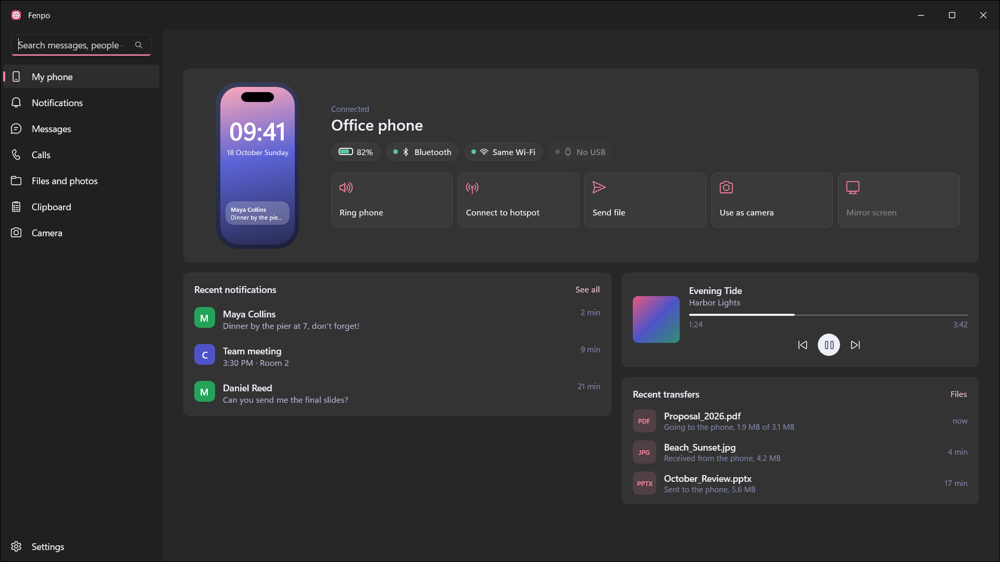

<p align="center">
  
</p>

# Fenpo

Fenpo links an iPhone or an Android phone to a Windows PC. There is no server and no account. Everything goes directly between your own devices over Bluetooth and the local network, encrypted.

The name is Latin: *fenestra* (window) + *pomum* (apple).



## What it does

With either phone:

- Phone notifications show up as Windows notifications. Dismiss them from the PC.
- Read and send text messages from the PC.
- Incoming calls appear in a small window at the top of the screen, with answer and decline. The call audio stays on the phone.
- Now playing card, keyboard media keys and the Windows media panel control the phone's music.
- Clipboard in both directions, with a history on the PC.
- Files and photos in both directions. File Explorer gets a "Send to phone with Fenpo" command. The PC also receives from LocalSend apps.
- Browse the phone's photo library from the PC.
- Open folders you share from the PC in the phone's Files app (iPhone) or file picker (Android).
- The phone as a webcam. Fenpo Kamera is a virtual camera that apps such as Teams or a browser can pick. Installing it asks for administrator approval once.
- The phone as the PC's touchpad, keyboard and presentation remote. Control the PC's music and volume from the phone.
- Lock the PC when the phone moves away. Lock it from the phone. Ring the phone from the PC and the PC from the phone.
- Join the phone's hotspot from the PC in one click, after typing its name and password into Fenpo on the phone once.
- The PC's notifications from apps you choose can be shown on the phone.

Where the two phones differ:

| | iPhone | Android |
|---|---|---|
| Notifications, messages, calls, media | Work without the Fenpo app, through the services iOS already offers over Bluetooth (ANCS, AMS, MAP) | Notifications and media come from the Fenpo app. Messages come from the phone's Bluetooth MAP; Fenpo does not ask for SMS permissions |
| Replying | Text messages, from the PC | Any notification with a reply action |
| Screen mirroring | View only. The broadcast is started on the iPhone. The PC's keyboard and mouse can be handed to the iPhone with Ctrl+Alt+I (the pointer needs AssistiveTouch) | View and control with the PC's mouse and keyboard, through an accessibility service you turn on. Phone audio comes along |
| Clipboard | A copy on the PC reaches the iPhone only while Fenpo is open. iOS does not let a background app read the clipboard, so sending from the iPhone takes a tap: Control Center, the Action button, Back Tap with a Shortcut, the share sheet, or opening Fenpo | Both directions |
| Webcam | Runs while Fenpo is open on the iPhone. Lens choice and zoom | Front or back camera, ultra-wide and zoom |

There is no contact sync: the iPhone refuses the PBAP connection. Names in Messages are picked up from notifications.

## How it works

There are four links between the phone and the PC:

1. BLE GATT to Apple's own services on the iPhone (notifications, media, battery, time). The PC is the client. No app needed.
2. Classic Bluetooth: MAP for messages. No app needed.
3. The Fenpo BLE channel. The PC is a GATT server, the phone connects to it. It carries small commands, short clipboard text, proximity and the PC's addresses, and it wakes the phone app when something larger is coming. Messages are sealed with AES-256-GCM using a key exchanged during pairing.
4. The Fenpo data channel. TLS 1.3 with pinned certificates on both sides, phone to PC on the local network. Files, photos, the camera and the screen go here.

Pairing is a QR code on the PC. It carries the PC's certificate fingerprint and a one-time token.

The Fenpo BLE channel needs a PC Bluetooth adapter that supports the peripheral role. On adapters without it, Fenpo turns that channel off.

[`protocol/`](protocol/README.md) is the contract the three apps share. The messages are Protocol Buffers in `protocol/fenpo/v1/`, and the Windows, iPhone and Android types are generated from them. Every connection starts with a `Hello` that lists capabilities, and each side only turns on what both support.

## Getting it

- Windows: [Microsoft Store](https://apps.microsoft.com/detail/9MTTKJ8BV1LG). Windows 11 22H2 or later, with Bluetooth.
- Android: [Google Play](https://play.google.com/store/apps/details?id=com.fenpo.android).
- iPhone: in App Store review.

Website: <https://fenpo.milvasoft.com>. Privacy policy: <https://fenpo.milvasoft.com/privacy>.

## Repository layout

This `main` branch has the Windows app, the protocol, the docs and the design files. The phone apps live on their own branches:

- iPhone: [`ios`](https://github.com/Milvasoft/fenpo/tree/ios), Swift and SwiftUI, in `ios/`
- Android: [`android`](https://github.com/Milvasoft/fenpo/tree/android), Kotlin and Jetpack Compose, in `android/`

```
windows/    .NET 10, WinUI 3, MSIX
  src/      Fenpo.App, Fenpo.Core, Fenpo.Bluetooth, Fenpo.Transport, Fenpo.Protocol,
            Fenpo.Sdk, Fenpo.ShellExtension, Fenpo.VirtualCamera
  tests/    Core, Bluetooth and Transport tests
  tools/    development and release scripts
protocol/   fenpo/v1/*.proto
docs/       plan, architecture, decisions, research
design/     HTML designs, logo, screenshots
spikes/     small experiments done before the product code
```

## Building the Windows app

You need:

- Windows 11 22H2 or later
- .NET 10 SDK
- Visual Studio 2026 with the C++ build tools. Fenpo Kamera and the File Explorer command are Native AOT DLLs and link with them. For an ARM64 build, add the MSVC ARM64 tools.
- Developer Mode, to register a development build
- A phone for anything beyond the UI. Bluetooth cannot be tested in a VM or emulator.

From `windows/`:

```powershell
dotnet test --project tests/Fenpo.Core.Tests
dotnet test --project tests/Fenpo.Bluetooth.Tests
dotnet test --project tests/Fenpo.Transport.Tests
dotnet build src/Fenpo.App -c Release -p:Platform=x64
```

To run it, build and register the output as a development package:

```powershell
.\tools\Register-Dev.ps1                      # x64, Debug
.\tools\Register-Dev.ps1 -Platform ARM64 -Configuration Release
```

Then start Fenpo from the Start menu. Only one copy of Fenpo runs at a time, so quit a Store install first. The Bluetooth parsers are tested against byte captures from real devices, with personal content replaced.

Logs are in `%LOCALAPPDATA%\Packages\Milvasoft.Fenpo_*\LocalState\logs\`.

## Docs

These are in Turkish:

- [docs/ARCHITECTURE.md](docs/ARCHITECTURE.md): the four links, Windows processes and projects, pairing and security
- [docs/DECISIONS.md](docs/DECISIONS.md): every decision and the reason for it
- [docs/windows/TESTING.md](docs/windows/TESTING.md): on-device test list for Windows

[protocol/README.md](protocol/README.md) is in English and covers framing, the BLE channel and pairing.

## Fenpo Cast

[Fenpo Cast](https://github.com/Milvasoft/fenpocast#readme) is a separate Android TV app. It receives an iPhone's screen, music and video, using the screen mirroring and audio output menus already on the iPhone. It lives in its own repository under GPL-3.0.

## License

MIT, for every branch of this repository. See [LICENSE](LICENSE).

<a href="https://www.opensourcealternatives.to"></a>
